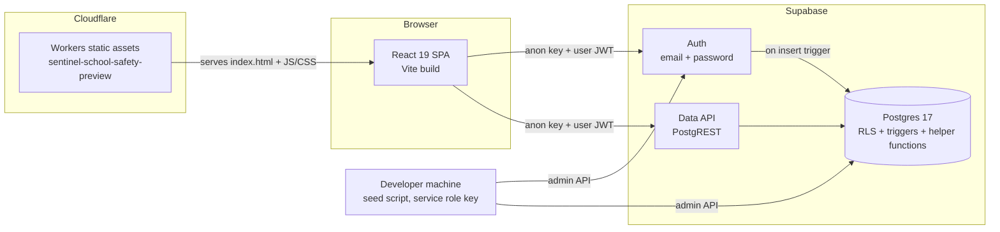
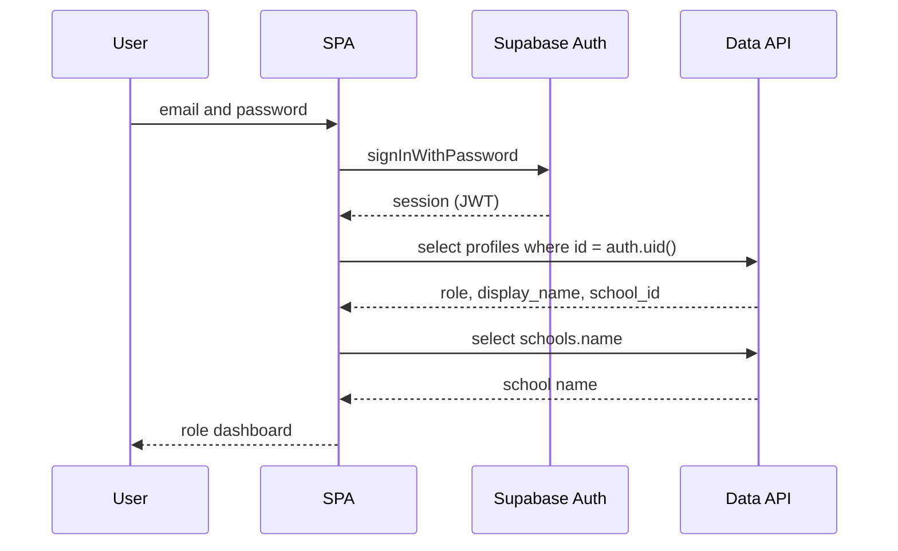

# SENTINEL System Design

Status as of 2026-10-22. Describes the deployed frontend and the live Supabase project
(`cshs-sentinel's Project`, region `ap-southeast-1`, Postgres 17). Where this document and the
repo disagree, the live database is authoritative (see [Known gaps](#known-gaps)).

## 1. Purpose and scope

SENTINEL is a school safety and learning environment. It covers surveys and check-ins, incident
and hazard reporting, alerts that require approval before publication, and school location and
schedule data. Each user belongs to one school and acts under one of eight roles.

This document covers the architecture, data model, access control, key flows, and deployment.
It does not cover visual design (see `.claude/skills/ui-ux-pro-max` for design guidance).

## 2. Architecture

- **Frontend**: a single-page React app. It is built with `tsc -b && vite build` into `dist/`, then
  deployed as static assets to a Cloudflare Worker with SPA fallback.
- **Auth**: Supabase Auth with email and password. The browser holds a user JWT after sign-in.
- **Data**: the browser reads and writes Postgres through Supabase's Data API. There is no custom
  backend server. Authorization is enforced by Row Level Security (RLS) in the database.
- **Ops**: the seed script uses the service role key. It runs only on a developer machine.

## 3. Components

| Component | Location | Responsibility |
| --- | --- | --- |
| Landing and dashboard UI | `src/App.tsx` | Header with theme toggle and sign-out, login card, per-role dashboard preview |
| Supabase client | `src/lib/supabase.ts` | Creates the client from `VITE_SUPABASE_URL` and `VITE_SUPABASE_ANON_KEY`. Throws at startup if either is missing |
| Role catalog | `src/roles.ts` | Display metadata for the eight roles. Must stay in sync with the `app_role` enum |
| Theme | `src/theme.ts` | Light and dark mode. Saved in `localStorage`. Defaults to the system preference |
| Demo accounts | `src/demo-accounts.json` | Shared demo password and one account per role. Used by the login card and the seed script |
| Seed script | `scripts/seed-sample-accounts.mjs` | Idempotently creates demo auth users and sets each profile's role and school. Uses `SUPABASE_SERVICE_ROLE_KEY` |
| Early migration | `supabase/migrations/202610220001_roles_and_access.sql` | Superseded. Describes a 4-role model that is not in the live database (see Known gaps) |
| Deployment config | `wrangler.jsonc` | Worker name, `./dist` assets, SPA fallback |

## 4. Data model

All tables are in the `public` schema. Each has RLS enabled.

| Table | Purpose |
| --- | --- |
| `schools` | Tenant. Every school-scoped row carries `school_id` |
| `profiles` | One row per auth user. Holds `role` (single `app_role`), `school_id`, `primary_location_id`, `is_active` |
| `locations` | School buildings, rooms, and areas. Has `parent_id` and a status |
| `location_categories` | Categories used to classify locations |
| `schedules` | Location schedules: day of week, times, effective dates |
| `submissions` | Survey and report submissions. `kind` separates general reports from `sentiment` (confidential wellbeing) items |
| `check_ins` | Per-user check-ins. Readable by the owner and by reviewers |
| `incidents` | Incident cases with a `case_ref`, status, category, location, acknowledgement, assignment, and resolution fields |
| `incident_notes` | Notes on an incident, written by a participant |
| `incident_status_history` | Status transitions for an incident |
| `incident_notifications` | Notifications raised for incidents. Readable by reviewers |
| `incident_case_refs` | Case reference records for incidents (purpose inferred from the name) |
| `report_attachments` | Files attached to a submission. Access follows the submission's scope |
| `alerts` | Announcements with `target_scope` (`all`, `role`, `responders`), `target_role`, versioning, and an approval and publish workflow |
| `weather_observations` | Weather readings for a school, read by school members |
| `audit_logs` | Record of changes to sensitive tables. Readable by school and system admins |

Triggers maintain `updated_at`, validate inserts and updates (`*_validate`), block reassigning a
row to another school (`*_no_school_reassign`), write audit entries (`*_audit`), and protect review
fields on submissions (`submissions_protect_review`). `incidents_notify` fires on incident insert.
A trigger on `auth.users` (`on_auth_user_created`) creates the matching `profiles` row for each
new account. The exact bodies of the notify and validate triggers were not reviewed for this
document.

## 5. Roles and access

Helper functions (all `SECURITY DEFINER`, `search_path = ''`):

| Function | Returns true when |
| --- | --- |
| `my_role()` | Returns the active caller's `app_role` |
| `my_school_id()` | Returns the active caller's school |
| `is_reviewer()` | Role is `security`, `drrm`, or `school_admin` |
| `is_admin()` / `is_school_admin()` | Role is `school_admin` |
| `is_system_admin()` | Role is `system_admin` |
| `submission_owner(id)` | Caller submitted that submission |
| `submittable_location(id)` | Location is in the caller's school and not archived |

Access summary, from the live policies:

| Role | Reports and check-ins | Incidents | Confidential (`sentiment`) submissions | Alerts | Admin data |
| --- | --- | --- | --- | --- | --- |
| Student | Insert own only (no policy to read submissions back) | Own only | No | Published, `all` or role `student` | No |
| Teacher | Insert own; read and update non-sentiment | Own only | No | Published, `all` or role `teacher` | No |
| Non-Teaching Staff | Insert own; read own | Own only | No | Published, `all` or role `non_teaching` | No |
| Security | Reviewer on all school check-ins and incidents | Read all in school | No | Published, responder-scoped | No |
| DRRM Coordinator | Reviewer; read and update non-sentiment | Read all in school | No | Create drafts (`created_by` = self); responder-scoped | No |
| Guidance Counselor | Read and update sentiment submissions | Own only | Yes | Published, `all` or role `guidance` | No |
| School Admin | Reviewer; read and update non-sentiment | Read all in school | No | Create drafts; approve and publish | Manage locations, categories, schedules; read profiles and audit log (school scope) |
| System Admin | Not reviewer | No | No | No | Audit log (school scope) |

Notes on the matrix:

- Confidentiality is enforced at the row level. Guidance is the only role that can read
  `sentiment` submissions. Staff roles exclude them through `kind <> 'sentiment'`.
- Only School Admins can create or update locations, categories, and schedules.
- The live `profiles` table has no UPDATE policy, so role and school changes are not possible
  through the app today. They are made with the service role.
- Alerts are created as drafts. Drafts can be updated only by their creator while still in draft.
- A user's `school_id` must match the row's `school_id` for every school-scoped table.

## 6. Key flows

### Sign-in and role lookup

The role is read from `profiles`, not from the client. Every later database call is checked
against the same role by RLS, so the UI's role display does not grant any access.

### Account creation

1. An account is created in `auth.users`, either through the seed script or by the auth provider.
2. The `on_auth_user_created` trigger inserts a `profiles` row with role `student`. It does not set
   `display_name`.
3. Role and school are set with the service role key. The seed script does this for demo accounts.
   No app flow or UPDATE policy currently lets an admin change them.

There is no self-service sign-up page in the app yet.

### Incident report

1. A signed-in user inserts an `incidents` row with `created_by = auth.uid()` and their own
   `school_id`. RLS rejects rows that do not match.
2. The `incidents_notify` trigger fires on insert. It is expected to create an
   `incident_notifications` row for reviewers (not verified in this document).
3. Reviewers (Security, DRRM, School Admin) see the incident and can acknowledge, assign, and
   add notes. Status history is kept in `incident_status_history`.
4. Reporters see their own incidents only.

### Alert approval

1. A DRRM Coordinator or School Admin creates an `alerts` row in `draft`, with `created_by`
   set to themselves.
2. Only School Admins can approve and publish (`approved_by`, `published_by`).
3. Once published, the alert is visible to the audience set by `target_scope` and `target_role`.
4. Cancelling records `cancelled_by` and `cancel_reason`. A new version can supersede an
   earlier alert (`supersedes_id`).

### Surveys and check-ins

Survey responses are stored in `submissions` with `kind`. Wellbeing check-ins are stored in
`check_ins`, which only the owner and reviewers can read. Only Guidance can review `sentiment`
submissions.

## 7. Security model

- **Public key in the browser.** The frontend uses only the publishable (anon) key, which is safe
  to ship because RLS guards every table.
- **Service role key stays local.** It is read by the seed script from the untracked `.env`. It is
  never prefixed with `VITE_` and never bundled.
- **Least privilege by default.** New accounts start as `student`. Role changes are made with the
  service role, not through the app. System Admins have no access to incidents, submissions, or
  alerts.
- **Confidential data.** Wellbeing (`sentiment`) submissions and check-ins are limited to the owner
  and Guidance (and to reviewers for check-ins). This is enforced in the database, not the UI.
- **Hardened functions.** Helper functions use `SECURITY DEFINER` with an empty `search_path`,
  which prevents search-path hijacking.
- **Audit.** Changes to sensitive tables are written to `audit_logs`.

## 8. Deployment and environments

| Item | Value |
| --- | --- |
| Frontend host | Cloudflare Workers, `sentinel-school-safety-preview` |
| Public URL | `https://sentinel-school-safety-preview.sentinelcshs.workers.dev` |
| Build | `npm run build` (`tsc -b && vite build`) |
| Deploy | `npm run deploy:preview` (build, then `wrangler deploy`) |
| Backend | Supabase project `vuqjfigoeuvjieznqyil`, region `ap-southeast-1` |
| Source | GitHub `cshs-sentinel/home`, branch `main` |

Required environment variables (see `.env.example`):

- `VITE_SUPABASE_URL` and `VITE_SUPABASE_ANON_KEY` are needed by the frontend build.
- `SUPABASE_SERVICE_ROLE_KEY` is needed only by the seed script.
- `CLOUDFLARE_API_TOKEN` is needed for `wrangler deploy`.
- `SUPABASE_ACCESS_TOKEN` and `DATABASE_PASSWORD` are for database administration. They are not
  used by the app.

There is one environment today. The live project serves as both production and the place where
demo accounts are created.

## 9. Known gaps

1. **Migration drift.** The repo migration defines a 4-role model (`sentinel_role`, `user_roles`,
   `role_audit_log`). The live database uses the 8-role `app_role` model and different tables.
   The repo migration cannot be applied to the live project. Migration history needs to be
   re-synced (for example with `supabase db pull`) before changes are made through migrations.
2. **Scoping bug in attachments policies.** In `report_attachments_select_scoped` and
   `report_attachments_delete_scoped`, the subquery compares `s.school_id = s.school_id`, which is
   always true. It should compare to `report_attachments.school_id`. The outer school check limits
   the impact, but the subquery should still be fixed.
3. **Mock data in the UI.** Dashboards are previews. They show static text, not live data. The
   submission, incident, and alert flows are not yet wired to the UI.
4. **No tests.** There are no automated tests for the frontend or for RLS policies.
5. **No password reset or sign-up flow** in the app.
6. **Secrets in the working copy.** `.env` holds real credentials, including the Supabase
   management token. It is gitignored, but its values appeared in the working session's logs.
   Rotating those credentials is recommended.

## 10. Open decisions

- Choose one role model and bring the migration history in line with it.
- Decide whether confidential reporting should be available to Security as well as Guidance.
- Choose the first live feature to wire to the database: survey submission, incident reporting,
  or alerts.
- Decide whether to add a staging project separate from the one that serves production.
