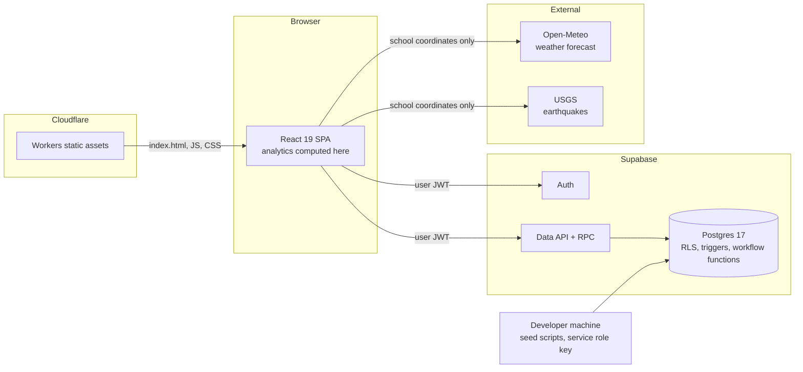

# SENTINEL System Design

Status as of 2026-10-22. Describes the frontend in this repo and the live Supabase project
(`cshs-sentinel's Project`, region `ap-southeast-1`, Postgres 17). Where this document and the
repo's migrations disagree, the live database is authoritative (see [Known gaps](#11-known-gaps)).

## 1. Purpose

SENTINEL helps a school keep its learning environment safe and motivating. It collects signals
from inside the school (how people feel, hazards, incidents, help requests) and outside it
(heat index, rain, wind, earthquakes). It turns those signals into prioritized insights so the
right people can act early. Each user belongs to one school and has one of eight roles.

Design principles:

- **Reporting takes a few taps.** On a phone, every report is made with buttons only. No typing.
- **Each role sees only what it needs.** The database enforces this, not just the UI.
- **Insights lead to actions.** An insight explains what is happening and offers the next step,
  such as drafting an alert.
- **Wellbeing data stays confidential.** Only Guidance reads individual feelings.

## 2. Architecture

- **Frontend:** a React single-page app, built with Vite and served as static assets by a
  Cloudflare Worker.
- **Data:** the browser talks to Postgres through Supabase's Data API. There is no custom server.
  Row Level Security (RLS) decides what each role can read and write. Status changes go through
  database functions (`transition_incident`, `approve_alert`, and others) that check the role
  themselves.
- **Analytics:** insights and charts are computed in the browser from the rows the user is already
  allowed to read. This keeps the confidentiality rules in one place, the database.
- **External data:** weather and earthquakes are fetched in the browser from public, keyless APIs.
  Only the school's coordinates are sent. No user data leaves the app.

## 3. Components

| Component | Location | Responsibility |
| --- | --- | --- |
| App shell | `src/App.tsx` | Login, greeting, alert banner, role tabs (bottom bar on phones) |
| Role catalog | `src/roles.ts` | The 8 roles, their labels, and which tabs each sees |
| Reporting | `src/components/ReportPanel.tsx` | Button-only flows: help, safe, feelings, hazard, incident, suggestion |
| Insights | `src/components/InsightsPanel.tsx` | Decision cards, KPIs, and charts per role |
| Queue | `src/components/QueuePanel.tsx` | Help requests, incident workflow, report review |
| Alerts | `src/components/AlertsPanel.tsx` | Weather, published alerts, drafting, approval |
| People | `src/components/PeoplePanel.tsx` | Role changes and the audit log |
| Charts | `src/components/Charts.tsx` | Stat tiles, bar lists, column and line charts with table views |
| Weather panel | `src/components/WeatherPanel.tsx` | Current heat index, today's peak, 14-day history |
| Value catalog | `src/lib/catalog.ts` | Button options that match the database CHECK constraints |
| Analytics | `src/lib/analytics.ts` | Aggregations, insight rules, alert templates |
| External data | `src/lib/weather.ts` | Open-Meteo and USGS clients, heat index, PAGASA levels |
| Data access | `src/lib/data.ts` | Role-aware loading and every write the app performs |
| Theme | `src/theme.ts` | Light, Dark, and Neon themes |
| Demo accounts | `scripts/seed-sample-accounts.mjs` | One login per role |
| Demo activity | `scripts/seed-demo-activity.mjs` | 14 days of synthetic, tagged activity; `--clean` removes it |
| Migrations | `supabase/migrations/` | `0001` is superseded (see gaps); `0002` fixes alert approval |

## 4. Data model

All tables are in `public`, have RLS enabled, and are scoped by `school_id`.

| Table | Holds | Values the app uses |
| --- | --- | --- |
| `profiles` | One row per user: `role`, `school_id`, `is_active` | 8 `app_role` values |
| `submissions` | Feelings, hazards, and observations | `kind`: `sentiment` (sub-types joy, calm, worried, stressed, sad, angry, lonely, hopeless; plus `stress_level` 1–5), `incident_hazard` (unsafe_condition, bullying, suspicious_activity), `observation` (safety_concern, report, suggestion). Status new → acknowledged → resolved |
| `check_ins` | Location check-ins | `status`: `safe` or `need_help` |
| `incidents` | Cases with a generated `case_ref` (`SNT-YYYY-NNNN`) | Category: emergency, medical, security, other. Status new → acknowledged → assigned → in_progress → resolved → closed, or cancelled |
| `incident_notifications` | One row per new incident, created by a trigger | Read by reviewers |
| `alerts` | Announcements | Severity info, advisory, urgent. Target everyone, responders, or one role. Status draft → approved → published, or cancelled / corrected |
| `locations` | Buildings, floors, rooms, open spaces | Active locations become the place buttons |
| `weather_observations` | Stored weather readings | Not used by the app yet (see gaps) |
| `audit_logs` | Role changes, alert workflow, and other changes to sensitive data | Read by school and system admins |

Database rules the app depends on:

- Every submission needs a message of at least 3 characters. Button-only reports generate one
  from the taps, for example "Feeling worried, stress 3 of 5 at Demo Library."
- A feeling needs a stress level. Other kinds must not have one.
- A person can have only one open incident created in the last 5 minutes. The app shows a
  friendly message when this limit is hit.
- Submissions cannot be edited except to move their review status forward.

## 5. Roles

| Role | Tabs | What they can do |
| --- | --- | --- |
| Student | Report, Alerts | Send help requests, check-ins, feelings, hazards, incidents, suggestions. Track their own incidents and check-ins. See alerts and weather. |
| Teacher | Report, Insights, Queue, Alerts | Everything a student can do. Review and resolve non-confidential reports. See report trends, hotspots, and bullying counts. |
| Non-Teaching Staff | Report, Alerts | Same as Student. |
| Security | Insights, Queue, Report, Alerts | See every incident and help request. Move incidents through the workflow. Review non-confidential reports. |
| DRRM Coordinator | Insights, Queue, Alerts, Report | Same as Security, plus drafting alerts. Weather and hazard insights offer a one-tap draft. |
| Guidance Counselor | Insights, Queue, Report, Alerts | The only role that reads individual feelings. Wellbeing analytics, follow-up queue, stress trends. |
| School Admin | Insights, Queue, Alerts, People, Report | Everything responders see, approving, publishing, and withdrawing alerts, changing roles, and the audit log. Sees only a **count** of open wellbeing reports. |
| System Admin | People, Report | Change roles (including System Admin) and read the audit log. No access to reports, incidents, or alerts. |

Enforcement:

- `is_reviewer()` is true for Security, DRRM, and School Admin. Reviewers read all incidents and
  check-ins in their school.
- Non-confidential submissions can be read by Teacher, Security, DRRM, and School Admin, filtered
  by `kind <> 'sentiment'`.
- Guidance reads and reviews all submissions, including feelings.
- `dashboard_counts()` gives School Admin the number of open wellbeing reports without the rows.
- `admin_set_user_role()` lets School and System Admins change roles in their school. Admins
  cannot change their own role, and only a System Admin can grant System Admin. Each change is
  written to the audit log.

## 6. Reporting (mobile-first, buttons only)

The Report tab opens with six large buttons:

| Button | Steps | Saved as |
| --- | --- | --- |
| I need help | Place → Send | `check_ins.status = need_help` |
| I'm safe | Place → Send | `check_ins.status = safe` |
| How I feel | Feeling (8 options) → Stress 1–5 → Place → Send | `submissions` kind `sentiment` |
| Report a hazard | Type (3) → Place → Send | `submissions` kind `incident_hazard` |
| Report an incident | Category (4) → Place → Send | `incidents` (case reference returned) |
| Suggest or observe | Type (3) → Place → Send | `submissions` kind `observation` |

Every place step has a Skip button. Each flow ends with a summary, a single large Send button, and
a short note on who can see the report. On phones, tap targets are at least 48 px, choices use
a 2-column grid, and the role tabs sit in a bottom bar.

## 7. Analytics and decision support

Insights are computed in the browser from the rows each role can read: the last 60 days of
submissions and incidents, check-ins, and the weather and earthquake feeds. A time filter
(7, 14, or 30 days) scopes the KPIs and charts.

### Insight rules

| Insight | Trigger | Who sees it | Action |
| --- | --- | --- | --- |
| Heat | Today's peak heat index ≥ 33 °C (PAGASA Extreme caution or worse) | All insight roles | DRRM and Admin: draft heat advisory |
| Rain / storm | Thunderstorm code, or any hour ≥ 7.5 mm, in the next 24 h | All insight roles | Draft rain advisory |
| Wind | Gusts ≥ 60 km/h (≥ 89 km/h is critical) | All insight roles | Draft wind advisory |
| Earthquake | M ≥ 5 within 300 km in 7 days, or M ≥ 4 within 100 km in 24 h | All insight roles | Draft building-check alert |
| Help requests | Any `need_help` check-in in 24 h | Security, DRRM, Admin | Go to Queue |
| Overdue incidents | Not acknowledged after 15 minutes | All insight roles that can read incidents | Acknowledge |
| Hotspot | One place with ≥ 3 reports in 7 days | All insight roles | Schedule an inspection |
| Bullying rising | This week ≥ 2 and ≥ 1.5 × last week | All insight roles | Coordinate with Guidance |
| Follow-ups | Unresolved feeling that is hopeless, lonely, or stress 5 | Guidance | Queue lists them first |
| Negative mood | ≥ 50% negative feelings this week (at least 5 reports) | Guidance | Wellbeing activity |
| Stress rising | Weekly average up by ≥ 0.5 | Guidance | Check exam clustering |
| Stress and heat | Average stress on hot days (peak ≥ 33 °C) vs cooler days, with at least 5 reports on each side | Guidance | Information only, described as a pattern, not a cause |

Insights are sorted by severity: Act now, Act soon, Watch, Note. Every status color comes with
an icon and a word.

### Dashboards

- **Guidance:** feelings shared, average stress, share of negative feelings, follow-ups. Charts
  for stress by day, how students feel, where feelings were shared, and other reports.
- **Teacher:** open reports, report volume, bullying count. Charts for reports per day, by type,
  and hotspots.
- **Security, DRRM, School Admin:** open incidents, not acknowledged, median time to acknowledge,
  help requests in 24 h, open hazards, and the open wellbeing count for Admin. Charts for daily
  volume, incidents by category, reports by type, and hotspots.

Every chart has a "View as table" option and keyboard focus. Charts use one series color per
theme, checked with the dataviz palette validator against each theme's surface.

### Alert workflow

1. An insight's **Draft alert** button, or a template button (Heat, Rain, Wind, Earthquake,
   Wellbeing), fills in the composer. DRRM or Admin sets severity and audience, then saves a draft.
2. School Admin approves, then publishes. The newest published alert appears as a banner for
   everyone.
3. School Admin can withdraw a published alert. The author or an Admin can cancel a draft.

## 8. External data

| Source | Data | Refresh |
| --- | --- | --- |
| Open-Meteo forecast API | Hourly temperature, humidity, rain, rain chance, weather code, gusts; 14 days back, 2 ahead | On load, then every 15 minutes |
| USGS earthquake feed | M ≥ 4 within 300 km over 7 days | Same |

The heat index uses the NWS Rothfusz formula with its standard adjustments. It was checked
against NWS reference values. PAGASA levels: below 27 °C comfortable, 27–32 caution, 33–41
extreme caution, 42–51 danger, 52 and above extreme danger.

The school location comes from `VITE_SCHOOL_LAT`, `VITE_SCHOOL_LON`, and `VITE_SCHOOL_PLACE`.
If they are not set, Manila is used, and the UI says so.

## 9. Security model

- The browser uses only the publishable key. RLS and workflow functions guard every read and write.
- The service role key is used only by local seed scripts and is never bundled.
- New accounts start as `student`.
- Individual feelings are readable only by Guidance. The person who sent a feeling cannot read it
  back, and School Admin sees only a count.
- External calls send only the school's coordinates.
- Helper functions use `SECURITY DEFINER` with an empty `search_path`.
- Role changes and the alert workflow are written to `audit_logs`.

## 10. Deployment

| Item | Value |
| --- | --- |
| Frontend | Cloudflare Workers `sentinel-school-safety-preview` |
| URL | `https://sentinel-school-safety-preview.sentinelcshs.workers.dev` |
| Build / deploy | `npm run build`; `npm run deploy:preview` |
| Backend | Supabase project `vuqjfigoeuvjieznqyil` |
| Source | GitHub `cshs-sentinel/home`, branch `main` |

There is one environment. The live project is also where the demo school, demo accounts, and
demo activity live.

## 11. Known gaps

1. **Migration drift.** `0001` describes a 4-role model that is not in the live database. The live
   schema was built outside this repo's migrations. Run `supabase db pull` to bring the history in
   line. `0002` (the alert approval fix) was applied directly and is recorded in the repo.
2. **No push notifications.** Help requests and incidents appear on dashboards but nobody is
   paged. Responders must have the app open.
3. **Weather is not stored.** The app reads weather live. `weather_observations` only holds test
   rows at coordinates 0,0. A scheduled job (edge function plus cron) would allow stored history
   and server-side alerts.
4. **No school coordinates in the database.** The location comes from build-time variables.
5. **Analytics run in the browser** over the last 60 days, capped at 2,000 submissions and
   1,000 incidents. Larger schools will need database views or RPCs that aggregate on the server.
6. **Report attachments policy.** In `report_attachments_select_scoped` and
   `report_attachments_delete_scoped`, the subquery compares `s.school_id = s.school_id`, which is
   always true. It should compare to `report_attachments.school_id`.
7. **Reporters cannot see past submissions.** No RLS policy lets a sender read their own
   feelings or reports. The app shows only their incidents and check-ins.
8. **Demo data is synthetic.** The demo school's analytics come from
   `seed-demo-activity.mjs`. Remove it with `--clean` before using real data.
9. **No automated tests**, no password reset, and no self-service sign-up.
10. **Credentials.** `.env` values appeared in a working session's logs. Rotate the Supabase
    management token, service role key, database password, Cloudflare token, and the GitHub token
    that was shared in chat.
