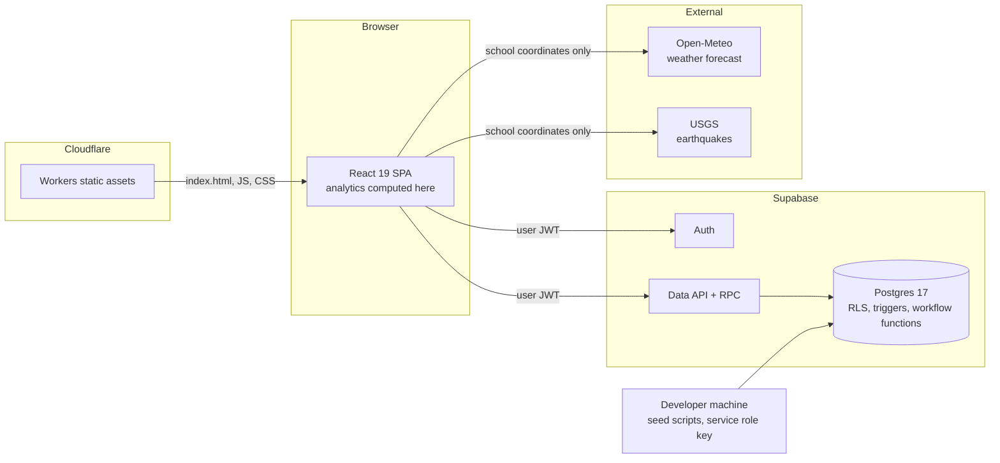

# SENTINEL System Design

Status as of 2026-10-22. Describes the frontend in this repo and the live Supabase project
(`cshs-sentinel's Project`, region `ap-southeast-1`, Postgres 17). Where this document and the
repo's migrations disagree, the live database is authoritative (see [Known gaps](#12-known-gaps)).

## 1. Purpose

SENTINEL helps a school keep its learning environment safe and motivating. It collects signals
from inside the school (how people feel, hazards, incidents, help requests) and outside it
(heat index, rain, wind, earthquakes). It turns those signals into prioritized insights so the
right people can act early. Each user belongs to one school and has one of eight roles.

Design principles:

- **Reporting takes a few taps.** On a phone, every report is made with buttons only. No typing.
- **Each role sees only what it needs.** The database enforces this, not just the UI.
- **Insights lead to actions.** An insight explains what is happening and offers the next step,
  such as drafting an alert.
- **Wellbeing data stays confidential.** Only Guidance reads individual feelings.

## 2. Architecture

- **Frontend:** a React single-page app, built with Vite and served as static assets by a
  Cloudflare Worker.
- **Data:** the browser talks to Postgres through Supabase's Data API. There is no custom server.
  Row Level Security (RLS) decides what each role can read and write. Status changes go through
  database functions (`transition_incident`, `approve_alert`, and others) that check the role
  themselves.
- **Analytics:** insights and charts are computed in the browser from the rows the user is already
  allowed to read. This keeps the confidentiality rules in one place, the database.
- **External data:** weather and earthquakes are fetched in the browser from public, keyless APIs.
  Only the school's coordinates are sent. No user data leaves the app.

## 3. Components

| Component | Location | Responsibility |
| --- | --- | --- |
| App shell | `src/App.tsx` | Login, greeting, alert banner, menus built from the user type (bottom bar on phones) |
| Role catalog | `src/roles.ts` | The 8 base roles and their labels |
| Feature catalog | `src/lib/features.ts` | Features, the most each base role can have, defaults, and menu order |
| Setup | `src/components/SetupPanel.tsx` | Locations tree, map layout, location types, user types |
| Layout editor | `src/components/LayoutEditor.tsx` | Drag-and-drop grid editor for the campus map |
| Map | `src/components/MapPanel.tsx` | Map tab: heatmap types, filters, drill-down, and per-place details |
| More menu | `src/components/MoreMenu.tsx` | Hidden menus with urgent badges |
| Overview map | `src/components/NestedMap.tsx` | Whole campus in one nested picture, auto-tiling undrawn places |
| Reporting | `src/components/ReportPanel.tsx` | Button-only flows: help, safe, feelings, hazard, incident, suggestion |
| Place picker | `src/components/PlacePicker.tsx` | Cascading dropdowns from campus down to room |
| Analytics | `src/components/AnalyticsPanel.tsx` | Analytics tab: decision cards, weather, KPIs, and charts per role |
| Queue | `src/components/QueuePanel.tsx` | Help requests, incident workflow, report review |
| Alerts | `src/components/AlertsPanel.tsx` | Weather, published alerts, drafting, approval |
| People | `src/components/PeoplePanel.tsx` | Assign user types and view the audit log |
| Charts | `src/components/Charts.tsx` | Stat tiles, bar lists, column and line charts with table views |
| Weather panel | `src/components/WeatherPanel.tsx` | Current heat index, today's peak, 14-day history |
| Value catalog | `src/lib/catalog.ts` | Button options that match the database CHECK constraints |
| Analytics | `src/lib/analytics.ts` | Aggregations, insight rules, alert templates |
| External data | `src/lib/weather.ts` | Open-Meteo and USGS clients, heat index, PAGASA levels |
| Data access | `src/lib/data.ts` | Role-aware loading and every write the app performs |
| Theme | `src/theme.ts` | Light, Dark, and Neon themes |
| Demo accounts | `scripts/seed-sample-accounts.mjs` | One login per role |
| Demo activity | `scripts/seed-demo-activity.mjs` | 14 days of synthetic, tagged activity; `--clean` removes it |
| Migrations | `supabase/migrations/` | `0001` is superseded (see gaps); `0002` fixes alert approval; `0003` adds location levels and user types; `0004` adds map layout fields; `0005` sets the Campus › Building › Floor › Room hierarchy; `0006` adds privacy-safe sentiment totals |

## 4. Data model

All tables are in `public`, have RLS enabled, and are scoped by `school_id`.

| Table | Holds | Values the app uses |
| --- | --- | --- |
| `profiles` | One row per user: `role`, `user_type_id`, `school_id`, `is_active` | 8 `app_role` values |
| `user_types` | Admin-defined user types per school | `base_role`, `features`, `is_active`, `is_system` for the 8 built-in types |
| `submissions` | Feelings, hazards, and observations | `kind`: `sentiment` (sub-types joy, calm, worried, stressed, sad, angry, lonely, hopeless; plus `stress_level` 1–5), `incident_hazard` (unsafe_condition, bullying, suspicious_activity), `observation` (safety_concern, report, suggestion). Status new → acknowledged → resolved |
| `check_ins` | Location check-ins | `status`: `safe` or `need_help` |
| `incidents` | Cases with a generated `case_ref` (`SNT-YYYY-NNNN`) | Category: emergency, medical, security, other. Status new → acknowledged → assigned → in_progress → resolved → closed, or cancelled |
| `incident_notifications` | One row per new incident, created by a trigger | Read by reviewers |
| `alerts` | Announcements | Severity info, advisory, urgent. Target everyone, responders, or one role. Status draft → approved → published, or cancelled / corrected |
| `location_categories` | Location types, such as Building, Room, or CR | `level` (tier) 1–5 and `environment` |
| `locations` | The campus tree, from campus to rooms and areas | `parent_id`, `category_id`, `status`. Active locations become the place buttons |
| `weather_observations` | Stored weather readings | Not used by the app yet (see gaps) |
| `audit_logs` | Role changes, alert workflow, and other changes to sensitive data | Read by school and system admins |

Database rules the app depends on:

- Every submission needs a message of at least 3 characters. Button-only reports generate one
  from the taps, for example "Feeling worried, stress 3 of 5 at Demo Library."
- A feeling needs a stress level. Other kinds must not have one.
- A person can have only one open incident created in the last 5 minutes. The app shows a
  friendly message when this limit is hit.
- Submissions cannot be edited except to move their review status forward.

## 5. Roles

These are the 8 base roles and the menus their built-in user types get. A System Admin can create
other user types on top of these roles (see [School setup](#6-school-setup)).

| Role | Default menus | What they can do |
| --- | --- | --- |
| Student | Report, Alerts | Send help requests, check-ins, feelings, hazards, incidents, suggestions. Track their own incidents and check-ins. See alerts and weather. |
| Teacher | Map, Analytics · More: Queue, Alerts, Report | Everything a student can do. Review and resolve non-confidential reports. See report trends, hotspots, and bullying counts. |
| Non-Teaching Staff | Report, Alerts | Same as Student. |
| Security | Map, Analytics · More: Queue, Alerts, Report | See every incident and help request. Move incidents through the workflow. Review non-confidential reports. |
| DRRM Coordinator | Map, Analytics · More: Queue, Alerts, Report | Same as Security, plus drafting alerts. Weather and hazard insights offer a one-tap draft. |
| Guidance Counselor | Map, Analytics · More: Queue, Alerts, Report | The only role that reads individual feelings. Wellbeing analytics, follow-up queue, stress trends. |
| School Admin | Map, Analytics · More: Queue, Alerts, Report, People | Everything responders see, approving, publishing, and withdrawing alerts, changing roles, and the audit log. Sees feelings only as privacy-safe totals per place, never individual entries. |
| System Admin | Setup, People, Report | Configure the campus and places, location types, and user types. Assign user types (including System Admin) and read the audit log. No access to reports, incidents, or wellbeing data. |

Navigation (`navFor()` in `src/lib/features.ts`):

- Roles with `insights.view` get **Map** and **Analytics** in the tab bar, and every other menu
  they can use (Queue, Alerts, Report, People, Setup) behind **More (⋯)**. More is a dropdown on
  desktop and a sheet above the bottom bar on phones.
- A red badge on More and on Queue keeps urgent work visible: help requests in the last 24 hours
  plus unacknowledged incidents for Security, DRRM, and School Admin, and unresolved crisis
  feelings (hopeless, lonely, or stress 5) for Guidance.
- Map and Analytics share one period (7, 14, or 30 days).
- Roles without `insights.view` keep a short flat tab bar and no More menu.

Enforcement:

- `is_reviewer()` is true for Security, DRRM, and School Admin. Reviewers read all incidents and
  check-ins in their school.
- Non-confidential submissions can be read by Teacher, Security, DRRM, and School Admin, filtered
  by `kind <> 'sentiment'`.
- Guidance reads and reviews all submissions, including feelings.
- `dashboard_counts()` gives School Admin the number of open wellbeing reports without the rows.
- `admin_set_user_type()` lets School and System Admins assign a user type in their school. It
  sets the person's base role to the type's base role. Admins cannot change their own type, and
  only a System Admin can assign or change a System Admin. Each change is written to the audit
  log. `admin_set_user_role()` still works and also moves the person to that role's built-in type.

## 6. School setup

The System Admin's **Setup** menu has three sections.

### Locations

The campus is a tree of places. Each place has a location type, and each type belongs to one
tier (`location_categories.level`):

| Tier | `level` | Goes inside | Example types |
| --- | --- | --- | --- |
| Campus (overall) | 1 | Top of the tree only | Campus |
| Building (1st level) | 2 | A campus | Building |
| Floor or wing (2nd level) | 3 | A building | Floor |
| Room (3rd level) | 4 | A floor or wing | Room, Classroom, Laboratory, Library, Office, Clinic, Canteen, CR (Comfort Room) |
| Other location | 5 | A campus, building, or floor | Gate, Parking, Sports Field, Covered Court, Garden, Corridor, Lobby |

Rules, enforced by the database (`validate_location`, using `location_fits()`, migration `0005`):

- Only a campus can be at the top of the tree.
- Each tier goes exactly one level below the one before: buildings in a campus, floors in a
  building, rooms in a floor. A single-storey building still has one floor (for example
  "Ground Floor").
- Other locations can go inside a campus, building, or floor. Nothing goes inside a room or an
  other location.
- Changing a place's type is refused if the places already inside it would no longer fit.
- Names are unique under the same parent, and codes are unique in the school.
- A place with active places inside it cannot be archived. A place cannot be added to, moved
  into, or restored under an archived place.
- Places are archived, not deleted, so past reports keep their location.

In the app the admin taps **+ Add campus**, then **+ Inside** on any place. The form only offers
types that fit at that spot.

### Map layout

Each place can hold a grid (24 × 16 by default; 12 to 40 per side). The places inside it are
drawn on that grid as blocks, stored as `layout_x`, `layout_y`, `layout_w`, `layout_h` on the
child and `grid_cols`, `grid_rows` on the parent (migration `0004`).

The editor is drag and drop only:

- Drag a place from the tray onto the grid to add it.
- Drag a block to move it, or drag its corner to resize it.
- Drag a block off the grid to remove it from the map. The place itself is not archived.
- Each drop saves immediately. Overlapping blocks get an orange outline.
- **Open ›** on a block edits the map inside it (campus → building → floor → rooms).

It uses pointer events, so it works with a mouse or a finger.

### Whole campus overview

Both maps have a **Whole campus** view (`NestedMap`) next to the one-level view. It draws the
entire tree in one picture: buildings contain their floors, floors contain their rooms, each at
the position the admin placed it. When a place's children are not drawn on its grid yet, they are
tiled automatically (treemap-style), so every place appears. A small "+N" badge marks places
that exist but are not drawn on a map that has other places drawn.

- In Setup › Map layout, tapping any block opens that level in the editor (a room opens its
  floor).
- In the **Map** tab, Whole campus is the default view. Rooms and other leaf places are shaded by
  the selected heatmap, so hotspots across all buildings show at once. Tapping a block shows its
  full path and latest items, and the table lists every place by full path.

### Map tab and heatmaps

Insight roles (Teacher, Security, DRRM, Guidance, School Admin) have a **Map** tab
(`src/components/MapPanel.tsx`) with the same layout. Each block is shaded by activity in the
selected period, counting everything inside that place. Controls, top to bottom: period, view
(Whole campus / One level), heatmap type, then type filter and "Still needs a response".

| Heatmap | Who | Shading | Type filter |
| --- | --- | --- | --- |
| All reports | All insight roles | Count of non-sentiment submissions and incidents | — |
| Incidents | All insight roles (Teacher and Guidance see only their own) | Count | Emergency, Medical, Security, Other |
| Hazards | All insight roles | Count of `incident_hazard` submissions | Unsafe condition, Bullying, Suspicious activity |
| Concerns and suggestions | All insight roles | Count of `observation` submissions | Safety concern, General report, Suggestion |
| Help requests | Security, DRRM, School Admin | Count of "I need help" check-ins | — |
| Sentiment | Guidance (own rows), School Admin (totals only) | Average stress, 1–5 | Guidance: Negative feelings only |

"Still needs a response" limits counts to open incidents and unresolved submissions. It does not
apply to Help requests or to the School Admin's Sentiment layer.

Tapping a block lists its latest items with their status, and **Open map ›** drills in. Reports
filed at the parent itself, and places not yet on the map, are listed under the grid so nothing
is hidden. Every map has a table view. Shading uses one sequential color per theme, and labels
sit on a surface chip so they stay readable at any intensity.

### Sentiment totals for School Admin

School Admins cannot read individual feelings. Their Sentiment heatmap comes from
`sentiment_by_location(p_days)` (migration `0006`), which only School Admin and Guidance can call:

- Each feeling counts toward its place and every place above it, computed in the database.
- Places with fewer than 3 feelings are not returned.
- **Complementary suppression:** inside any place that is shown, the feelings that are hidden
  (hidden child places plus feelings filed at the place itself) must total 0 or at least 3.
  Otherwise the smallest shown child, or the place itself, is hidden too, and the check repeats.
  This stops a small group from being worked out by subtracting shown totals from a parent total.
- The map shows hidden places as "too few", and the details panel shows totals only, with no
  list of entries.

### Location types

Admins add, rename, and turn off types, and choose each type's tier and environment (indoor,
outdoor, or either). A type's tier cannot change while active places use it
(`validate_location_category`).

### User types

A user type has a name, an optional description, a **base role**, and a set of **features**.

- The base role decides what the database allows: which rows the person can read and write. RLS
  is unchanged and keeps the confidentiality rules (only Guidance reads individual feelings).
- Features decide what the person sees: the menus and each report button.
- A type can never have a feature its base role does not allow. The database rejects it
  (`validate_user_type`, using `role_feature_ceiling()`), and the app greys those features out.
- Each school has 8 built-in types, one per base role. They cannot be turned off or change base
  role, but their features can be edited.
- A type's base role cannot change, and the type cannot be turned off, while people have it.

Features:

| Feature | Shows | Allowed base roles |
| --- | --- | --- |
| `report.help`, `report.safe`, `report.feeling`, `report.hazard`, `report.incident`, `report.observation` | The six report buttons | All |
| `alerts.view` | Alerts menu (weather and published alerts) | All |
| `insights.view`, `queue.view` | Map, Analytics, and Queue menus | Teacher, Security, DRRM, Guidance, School Admin |
| `alerts.draft` | Drafting alerts | DRRM, School Admin |
| `alerts.approve` | Approving, publishing, withdrawing alerts | School Admin |
| `people.manage` | People menu | School Admin, System Admin |
| `setup.locations` | Setup: locations and location types | School Admin, System Admin |
| `setup.user_types` | Setup: user types | System Admin |

Example: **Canteen Staff**, base role Non-Teaching Staff, with I need help, I'm safe, Report a
hazard, Report an incident, and Alerts. Canteen staff see only those 4 report buttons and the
Alerts menu.

Turning a feature off hides it in the app. The base role is still the security boundary: a person
whose base role allows an action can technically still perform it through the API.

## 7. Reporting (mobile-first, buttons only)

The Report tab opens with six large buttons:

| Button | Steps | Saved as |
| --- | --- | --- |
| I need help | Place → Send | `check_ins.status = need_help` |
| I'm safe | Place → Send | `check_ins.status = safe` |
| How I feel | Feeling (8 options) → Stress 1–5 → Place → Send | `submissions` kind `sentiment` |
| Report a hazard | Type (3) → Place → Send | `submissions` kind `incident_hazard` |
| Report an incident | Category (4) → Place → Send | `incidents` (case reference returned) |
| Suggest or observe | Type (3) → Place → Send | `submissions` kind `observation` |

The place step (`PlacePicker`) is a set of cascading dropdowns that follows the location tiers:
Campus, then Building or area, then Floor, wing, or area, then Room or area. Each dropdown lists
only the places inside the choice above it, so nobody scrolls a flat list of every room. With one
campus it is pre-selected. "Anywhere in …" stops at the current level, and the review shows the
full path (for example "Admin › 1st Floor › Room 101"). A Skip button sends without a place.

Each flow ends with a summary, a single large Send button, and
a short note on who can see the report. On phones, tap targets are at least 48 px, choices use
a 2-column grid, and the role tabs sit in a bottom bar.

## 8. Analytics and decision support

Insights are computed in the browser from the rows each role can read: the last 60 days of
submissions and incidents, check-ins, and the weather and earthquake feeds. A time filter
(7, 14, or 30 days) scopes the KPIs and charts.

### Insight rules

| Insight | Trigger | Who sees it | Action |
| --- | --- | --- | --- |
| Heat | Today's peak heat index ≥ 33 °C (PAGASA Extreme caution or worse) | All insight roles | DRRM and Admin: draft heat advisory |
| Rain / storm | Thunderstorm code, or any hour ≥ 7.5 mm, in the next 24 h | All insight roles | Draft rain advisory |
| Wind | Gusts ≥ 60 km/h (≥ 89 km/h is critical) | All insight roles | Draft wind advisory |
| Earthquake | M ≥ 5 within 300 km in 7 days, or M ≥ 4 within 100 km in 24 h | All insight roles | Draft building-check alert |
| Help requests | Any `need_help` check-in in 24 h | Security, DRRM, Admin | Go to Queue |
| Overdue incidents | Not acknowledged after 15 minutes | All insight roles that can read incidents | Acknowledge |
| Hotspot | One place with ≥ 3 reports in 7 days | All insight roles | Schedule an inspection |
| Bullying rising | This week ≥ 2 and ≥ 1.5 × last week | All insight roles | Coordinate with Guidance |
| Follow-ups | Unresolved feeling that is hopeless, lonely, or stress 5 | Guidance | Queue lists them first |
| Negative mood | ≥ 50% negative feelings this week (at least 5 reports) | Guidance | Wellbeing activity |
| Stress rising | Weekly average up by ≥ 0.5 | Guidance | Check exam clustering |
| Stress and heat | Average stress on hot days (peak ≥ 33 °C) vs cooler days, with at least 5 reports on each side | Guidance | Information only, described as a pattern, not a cause |

Insights are sorted by severity: Act now, Act soon, Watch, Note. Every status color comes with
an icon and a word.

### Dashboards

- **Guidance:** feelings shared, average stress, share of negative feelings, follow-ups. Charts
  for stress by day, how students feel, where feelings were shared, and other reports.
- **Teacher:** open reports, report volume, bullying count. Charts for reports per day, by type,
  and hotspots.
- **Security, DRRM, School Admin:** open incidents, not acknowledged, median time to acknowledge,
  help requests in 24 h, open hazards, and the open wellbeing count for Admin. Charts for daily
  volume, incidents by category, reports by type, and hotspots.

Every chart has a "View as table" option and keyboard focus. Charts use one series color per
theme, checked with the dataviz palette validator against each theme's surface.

### Alert workflow

1. An insight's **Draft alert** button, or a template button (Heat, Rain, Wind, Earthquake,
   Wellbeing), fills in the composer. DRRM or Admin sets severity and audience, then saves a draft.
2. School Admin approves, then publishes. The newest published alert appears as a banner for
   everyone.
3. School Admin can withdraw a published alert. The author or an Admin can cancel a draft.

## 9. External data

| Source | Data | Refresh |
| --- | --- | --- |
| Open-Meteo forecast API | Hourly temperature, humidity, rain, rain chance, weather code, gusts; 14 days back, 2 ahead | On load, then every 15 minutes |
| USGS earthquake feed | M ≥ 4 within 300 km over 7 days | Same |

The heat index uses the NWS Rothfusz formula with its standard adjustments. It was checked
against NWS reference values. PAGASA levels: below 27 °C comfortable, 27–32 caution, 33–41
extreme caution, 42–51 danger, 52 and above extreme danger.

The school location comes from `VITE_SCHOOL_LAT`, `VITE_SCHOOL_LON`, and `VITE_SCHOOL_PLACE`.
If they are not set, Manila is used, and the UI says so.

## 10. Security model

- The browser uses only the publishable key. RLS and workflow functions guard every read and write.
- The service role key is used only by local seed scripts and is never bundled.
- New accounts start as `student`.
- Individual feelings are readable only by Guidance. The person who sent a feeling cannot read it
  back, and School Admin sees only a count.
- External calls send only the school's coordinates.
- Helper functions use `SECURITY DEFINER` with an empty `search_path`.
- Role changes and the alert workflow are written to `audit_logs`.

## 11. Deployment

| Item | Value |
| --- | --- |
| Frontend | Cloudflare Workers `sentinel-school-safety-preview` |
| URL | `https://sentinel-school-safety-preview.sentinelcshs.workers.dev` |
| Build / deploy | `npm run build`; `npm run deploy:preview` |
| Backend | Supabase project `vuqjfigoeuvjieznqyil` |
| Source | GitHub `cshs-sentinel/home`, branch `main` |

There is one environment. The live project is also where the demo school, demo accounts, and
demo activity live.

## 12. Known gaps

1. **Migration drift.** `0001` describes a 4-role model that is not in the live database. The live
   schema was built outside this repo's migrations. Run `supabase db pull` to bring the history in
   line. `0002` (the alert approval fix) was applied directly and is recorded in the repo.
2. **No push notifications.** Help requests and incidents appear on dashboards but nobody is
   paged. Responders must have the app open.
3. **Weather is not stored.** The app reads weather live. `weather_observations` only holds test
   rows at coordinates 0,0. A scheduled job (edge function plus cron) would allow stored history
   and server-side alerts.
4. **No school coordinates in the database.** The location comes from build-time variables.
5. **Analytics run in the browser** over the last 60 days, capped at 2,000 submissions and
   1,000 incidents. Larger schools will need database views or RPCs that aggregate on the server.
6. **Report attachments policy.** In `report_attachments_select_scoped` and
   `report_attachments_delete_scoped`, the subquery compares `s.school_id = s.school_id`, which is
   always true. It should compare to `report_attachments.school_id`.
7. **Reporters cannot see past submissions.** No RLS policy lets a sender read their own
   feelings or reports. The app shows only their incidents and check-ins.
8. **Demo accounts share the real school.** The demo campus, demo activity, and original sample
   rows were deleted on 2026-10-22. The 8 demo accounts still sign in to the same school as the
   real Cabiao SHS setup, so anything they report lands in real analytics. A separate test
   school would keep them apart.
9. **No automated tests**, no password reset, and no self-service sign-up.
10. **Features are not enforced by the database.** Turning a feature off hides it in the app, but
    the base role still allows the action through the API. Enforcing report features in the
    insert policies would close this.
11. **No school or campus assignment for new accounts.** New sign-ups get the Student role and no
    school. There is no screen yet to place an account in a school.
12. **Credentials.** `.env` values appeared in a working session's logs. Rotate the Supabase
    management token, service role key, database password, Cloudflare token, and the GitHub token
    that was shared in chat.
